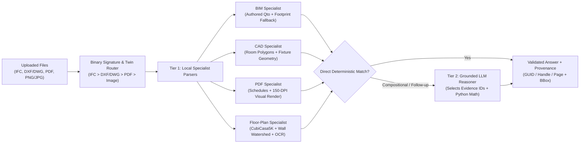

# Stoa — Verifiable Construction Drawing & BIM Question Answering

**Stoa** answers natural-language questions (in English, Finnish, German, French, Estonian, and Danish) across architectural construction drawings and BIM models (**IFC**, **DXF/DWG**, **Vector & Raster PDF**, and **Raster Floor Plans**), built for the **Stoa Challenge at Junction 2026**.

Every answer is grounded in deterministic local specialist parsers and carries **machine-checkable provenance** so an engineer or reviewer can verify it in seconds:
- **BIM (`IFC`)** — `GlobalId` (`GUID`), Express entity ID, `IfcType`, and spatial `IfcBuildingStorey` containment.
- **CAD (`DXF` / `DWG`)** — Entity `handle`, semantic layer, apartment unit outline, and 2D bounding box (`bbox`).
- **PDF Schedules & Sheets (`PDF`)** — 1-based `page` number, matched schedule row/cell text, and `bbox` in PDF points.
- **Raster Drawings (`PNG` / `JPG` / `TIFF`)** — Segmented room/symbol `bbox` in image pixels with interactive SVG region highlights in the web UI.

When required quantities, labels, or calibrated scales are absent from the drawing, Stoa **abstains (`not_found`) rather than guessing**.

---

## Architecture



### Key Design Principles
1. **Automatic Format Twin Priority (`IFC > DXF/DWG > Vector PDF > Raster Image`)**: Drawings sharing a canonical stem (including `<model>_plan-*` sheets paired with `<model>.ifc`) are linked into a single drawing group and routed to the highest-precision source first.
2. **Authored Quantities First, Geometry Fallback Second**: IFC room/wall/slab queries read authored `Qto_*` sets scaled by project units first, falling back to `ifcopenshell.geom` footprint/volume triangulation only when authored quantities are absent (explicitly labeled in `method`).
3. **Geometry-First Floor-Plan Segmentation**: Raster floor plans are verified using rotation-invariant CLIP + structural wall-topology geometry, then segmented with a standalone 44-channel `FurukawaHourglass` network (auto-downloading the official CubiCasa5K checkpoint on first use, with automatic CUDA SM compatibility checks and CPU fallback) plus a weight-free OpenCV distance-transform watershed fallback. Partial OCR text labels are never used to estimate general room counts.
4. **2-Tier Hybrid QA & Grounded LLM Reasoning**:
   - **Tier 1** answers standard count, area, length, volume, and schedule lookups locally and deterministically with zero external API dependency.
   - **Tier 2 (`llm_reasoner.py`)** handles multi-turn follow-ups, subset exclusions (e.g., *"rooms excluding hallways and storage"*), cross-category sums, and file disambiguation. Local parsers build compact `EvidencePack`s where each room/symbol/space/row gets a stable ID (`R*`, `I*`, `S*`, `SR*`); Gemini (`gemini-2.5-flash` with automatic multi-model timeout fallback) or OpenAI selects matching IDs and an operation (`count_selected`, `sum_attribute`, `min_attribute`, `max_attribute`, `direct_value`), while **Python deterministically computes all arithmetic** and attaches ground-truth citations.

---

## Benchmark Results (`junction-dataset-preview`)

| Dataset Source | Format | Score | Accuracy | Notes |
|---|---|---:|---:|---|
| `swiss_dwellings` | `DXF` (+ PDF/PNG twins) | **2,338 / 2,358** | **99.2%** | `1,614 / 1,614` (`100.0%`) counts; `724 / 744` (`97.3%`) areas (`±2%`) |
| `ifc_models` | `IFC` | **1,023 / 1,049** | **97.5%** | `844 / 844` (`100.0%`) available IFC net floor areas |
| `opening_design` | `PDF` (schedules & sheets) | **61 / 64** | **95.3%** | Multi-table schedule extraction & parallel row unmerging |
| `ifc_bench` | `IFC` (free-form text QA) | *0.565 token F1* | — | Authored property, material, storey & fire-rating synthesis |
| **Non-image overall** | **IFC + DXF + PDF** | **3,424 / 3,720** | **92.0%** | **Numeric accuracy: `3,409 / 3,455` (`98.7%`)** |
| `cubicasa5k` | `PNG` (raster floor plans) | **241 / 241** cls | **100.0%** | Floor-plan auto-classification recall + pixel-bbox room/icon segmentation |

---

## Repository Structure

| File | Purpose |
|---|---|
| `chat_api.py` | FastAPI server exposing conversation-scoped file upload, drawing preview, type override, and QA endpoints |
| `static/index.html` | Single-page browser chat UI with multi-file sidebar, confidence badges, and SVG bounding-box overlays |
| `conversation_pipeline.py` | Per-conversation manifest, twin grouping, lazy parser cache, and 2-tier deterministic + LLM router |
| `llm_reasoner.py` | Structured `EvidencePack` builders, Gemini/OpenAI schema-constrained reasoning, and Python arithmetic/guardrails |
| `file_classifier.py` | Binary signature detection, dataset source routing, and CLIP + structural raster drawing classifier |
| `bim_parser.py` / `bim_qa.py` | IFC spatial/property/quantity extraction, geometric footprint fallback, and multilingual BIM text/area QA |
| `ifc_qa.py` | IFC element counts by storey/type and authored/geometric wall & slab lengths, side areas, and volumes |
| `cad_qa.py` / `cad_parser.py` | Semantic DXF/DWG room polygon & fixture geometry analysis plus ODA DWG conversion |
| `pdf_parser.py` | Vector & OCR PDF schedule extraction, header linking, dimension lookup, and 150-DPI visual page rendering |
| `image_parser.py` | Raster OCR, standalone CubiCasa5K segmentation, CUDA/CPU fallback, and OpenCV wall-watershed geometry |
| `floorplan_geometry_model.py` | Standalone `FurukawaHourglass` (44-channel room/icon architecture) and multi-task geometry network |
| `floorplan_model.py` | Floor-plan count category taxonomy, evaluation split helpers, and optional shared CNN counter |
| `room_label_qa.py` | 4-orientation RapidOCR extractor for Finnish floor-plan room labels (`WC`, `S`, `PARVEKE`, storeys) |
| `evaluate_all.py` | Unified benchmark runner across all sources (`--sources`, `--holdout-only`, `--failures-out`) |
| `evaluate_bim_area.py` | Targeted evaluator for IFC space and storey net floor area questions |
| `evaluate_cad.py` | Targeted evaluator for DXF floor-plan count and area questions |
| `evaluate_pdf_text.py` | Targeted evaluator for PDF schedule and specification questions |
| `AGENTS.md` / `DECISIONS.md` | Shared engineering contracts, provenance rules, and architectural decision log |

---

## Quickstart

### 1. Install Dependencies
Python **3.10+** is required. Install PyTorch for your platform (CUDA or CPU) and then install the project requirements:

```bash
pip install -r requirements.txt
```

> **Note:** On first floor-plan query, Stoa automatically downloads the pretrained CubiCasa5K segmentation weights (`model_best_val_loss_var.pkl`) into `models/` if not already present locally, and automatically falls back to CPU if the host GPU architecture is unsupported by the installed PyTorch build.

### 2. Configure Optional LLM Compositional Reasoning (`.env`)
Tier-1 deterministic specialists work completely offline without any API keys. To enable Tier-2 compositional reasoning (subset exclusions, cross-category sums, conversational follow-ups), create a `.env` file in the repository root:

```ini
GEMINI_API_KEY=your_gemini_api_key_here
# Optional overrides:
# GEMINI_MODEL=gemini-2.5-flash
# OPENAI_API_KEY=sk-...
# STOA_CUBICASA_WEIGHTS=models/model_best_val_loss_var.pkl
```

### 3. Run the Interactive Web Application
Start the FastAPI server with a single worker (sessions are kept in-memory per process):

```bash
uvicorn chat_api:app --host 0.0.0.0 --port 8000 --workers 1
```

Open `http://127.0.0.1:8000` in your browser to upload `.ifc`, `.dxf`, `.dwg`, `.pdf`, or `.png`/`.jpg` drawings, ask questions in any supported language, and inspect highlighted bounding-box citations. *(After pulling new commits on a remote server, restart the `uvicorn` process so updated parsers and guardrails take effect.)*

---

## Running Evaluations

Place the dataset at `junction-dataset-preview/` (`questions.jsonl` + `data/<source>/...`) and run:

```bash
# Overall benchmark across all formats
python evaluate_all.py --questions junction-dataset-preview/questions.jsonl --data junction-dataset-preview/data --failures-out failures.jsonl

# Targeted specialist benchmarks
python evaluate_bim_area.py --questions junction-dataset-preview/questions.jsonl --data junction-dataset-preview/data
python evaluate_cad.py --questions junction-dataset-preview/questions.jsonl --data junction-dataset-preview/data
python evaluate_pdf_text.py --questions junction-dataset-preview/questions.jsonl --data junction-dataset-preview/data
```
